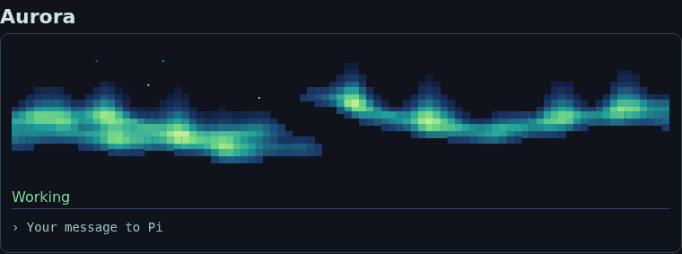

# pi-animations

[](https://www.npmjs.com/package/@puh00/pi-animations)
[](LICENSE)

Full-width Aurora, Ocean and Galaxy animations for [Pi](https://pi.dev). They adapt to terminal width and stop when a run ends or is cancelled.




## Install and try

Requires Pi 1.3.0 or newer.

```sh
pi install npm:@puh00/pi-animations
```

Run `/reload` in an open Pi session. To try the extension for one session without changing your settings, run `pi -e npm:@puh00/pi-animations`.

In Pi, select an animation, preview it, then send a prompt:

```text
/animation aurora
/animation preview
```

Choose Ocean with `/animation ocean` or Galaxy with `/animation galaxy`. Press any key to close the preview. Send a normal prompt to see the animation while Pi works.

## Try a local checkout

Requires Pi 1.3.0 or newer. From the repository root, install the development dependencies and start Pi with the local extension:

```sh
npm ci --ignore-scripts
pi --no-extensions --extension ./index.ts
```

This loads the checkout for that session without installing the package or changing your Pi settings. `--no-extensions` disables automatically loaded extensions to avoid loading an installed copy too. Omit it if you need your other extensions and have not already installed pi-animations.

In Pi, select Ocean and open its preview:

```text
/animation ocean
/animation preview
```

Press any key to close the preview. Send a normal prompt to see the animation while Pi works. After editing the source, run `/reload`, then preview again. No build step is needed.

For a browser-only preview, run `npm run preview` and open `.lavish/preview.html`. See [verification.md](verification.md) for automated checks, including Pi tests that use a local provider without model credentials.

## Usage

```text
/animation                 Enable Aurora, the default
/animation aurora          Select Aurora
/animation ocean           Select Ocean
/animation galaxy          Select Galaxy
/animation preview         Preview the current selection
/animation off             Restore Pi's normal indicator
```

Type `/animation ` to see argument suggestions, or start typing a name to filter them.

Selections, including `off`, are saved in `pi-animations.json` in Pi's agent directory and used when a session starts. Open sessions keep their own selection until restarted. If the file is missing or invalid, the extension uses the session's previous selection or Aurora. Previewing does not change the saved selection. `/animation off` restores Pi's normal indicator. `ASCIIFX_REDUCED_MOTION=1` and `TERM=dumb` disable animation timers. `NO_COLOR` renders animations without color.

## Acknowledgements

Aurora comes from [cyperx84/ascii-animations](https://github.com/cyperx84/ascii-animations). Ocean comes from [paulrobello/termflix](https://github.com/paulrobello/termflix). Galaxy is adapted from [ZviBaratz/fresco](https://github.com/ZviBaratz/fresco). See [THIRD_PARTY_NOTICES.md](THIRD_PARTY_NOTICES.md) for their licenses.
